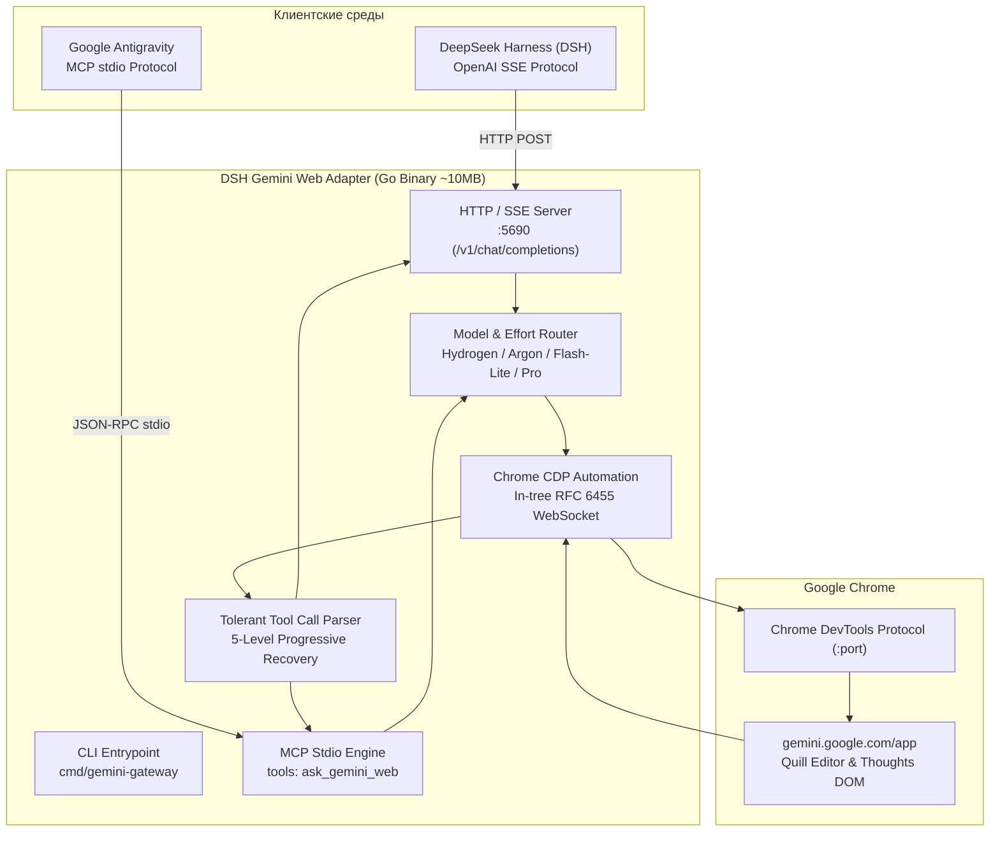

# DSH Gemini Web Adapter (Go Edition) 🚀

Высокопроизводительный автономный шлюз на языке **Go** для интеграции веб-интерфейса Google Gemini (Google AI Pro: **Gemini 4 Hydrogen**, **Gemini 3.5 Flash-Lite**, **Gemini 3.1 Pro**, **Gemini 4 Argon**) с экосистемами **DeepSeek Harness (DSH)** и **Google Antigravity**.

Полная замена Node.js-шлюза на чистом Go: **0 внешних зависимостей** (zero external dependencies), потребление оперативной памяти всего **15–20 МБ**, мгновенный запуск за **5 мс** и единый бинарный файл.

---

## 🌟 Ключевые возможности

- ⚡ **Zero-Dependency Architecture:** Скомпилирован исключительно на стандартной библиотеке Go и встроенной реализации клиента RFC 6455 WebSocket.
- 🧠 **Thinking & Multimodal:** Полная поддержка мультимодальности (прикрепление скриншотов и файлов через синтетические события ClipboardEvent/DragEvent) и передача рассуждений (`reasoning_content`) в потоковом SSE режиме.
- 🛠️ **Отказоустойчивый парсер Tool Calls:** 5-уровневая система эвристического восстановления поврежденного JSON от LLM (экранирование путей Windows, удаление комментариев JS, закрытие скобок, устранение висячих запятых).
- 🔌 **Двойной режим работы (HTTP Gateway + Antigravity MCP):**
  - **HTTP/SSE Server (`--port 5690`):** Полная совместимость со спецификацией OpenAI Chat Completions API для DeepSeek Harness.
  - **MCP Stdio Server (`--mcp`):** Нативная интеграция с **Google Antigravity** в качестве Model Context Protocol сервера (`ask_gemini_web`, `gemini_web_status`).
- 🛡️ **Anti-Canvas & Anti-Sandbox Directives:** Автоматическое подавление внутренних интерфейсов Gemini (Canvas, Workspace extensions) и подтверждение диалогов загрузки файлов.
- 🌐 **Auto-Proxy Probing:** Автоматическое обнаружение локальных прокси (SOCKS5/HTTP на портах 10808, 7890, 1080, 10809).

---

## 📊 Матрица моделей

| Идентификатор модели DSH | Модель в веб-интерфейсе | Режим рассуждений | Мультимодальность | Назначение |
|---|---|---|---|---|
| `gemini-4-hydrogen-high` | **4 Hydrogen** | Высокий (High) | Текст + Изображения | Комплексные инженерные задачи |
| `gemini-4-hydrogen-medium` | **4 Hydrogen** | Средний (Medium) | Текст + Изображения | Оптимальный баланс рассуждений |
| `gemini-4-hydrogen-low` | **4 Hydrogen** | Низкий (Low) | Текст + Изображения | Быстрые ответы с кратким обоснованием |
| `gemini-3.5-flash-lite` | **3.5 Flash-Lite** | — | Текст + Изображения | Мгновенные ответы с минимальной задержкой |
| `gemini-3.1-pro-high` | **3.1 Pro** | Высокий (High) | Текст + Изображения | Исследования и многоуровневый анализ |
| `gemini-4-argon-high` | **4 Argon** | Высокий (High) | Текст + Изображения | Кодогенерация, аудит и архитектура |

---

## 🚀 Сборка и запуск

### 1. Сборка бинарника
```bash
git clone https://github.com/kahanaalita/dsh-gemini-web-adapter-go.git
cd dsh-gemini-web-adapter-go
go build -o bin/gemini-gateway ./cmd/gemini-gateway
```

### 2. Запуск в режиме HTTP Gateway (для DeepSeek Harness)
```bash
./bin/gemini-gateway --port 5690 --base ~/.dsh-gemini-web-adapter-go
```

### 3. Запуск в режиме MCP Server (для Antigravity)
Добавьте сервер в настройки Antigravity (`~/.gemini/antigravity/mcp.json` или конфигурацию плагина):
```json
{
  "mcpServers": {
    "gemini-web": {
      "command": "/Users/kahanaalita/.gemini/antigravity/scratch/dsh-gemini-web-adapter-go/bin/gemini-gateway",
      "args": ["--mcp"]
    }
  }
}
```

---

## 🏛️ Архитектура



---

## 📄 Лицензия
MIT License © 2026 kahanaalita
