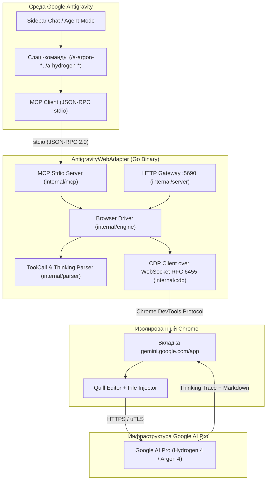

# AntigravityWebAdapter (Go Edition) 🚀

> **Высокопроизводительный автономный Go-адаптер и MCP-сервер для бесшовной интеграции Google Antigravity с веб-версией Google AI Pro** (модели **Gemini 4 Hydrogen**, **Gemini 4 Argon**).

`AntigravityWebAdapter` связывает интерфейс Antigravity с веб-интерфейсом `gemini.google.com/app`, позволяя использовать полную мощь моделей тарифа Google AI Pro без поминутной тарификации внешних облачных API (Vertex AI / Generative Language API).

Реализация выполнена на чистом Go: **0 внешних зависимостей** (zero external dependencies), мгновенный холодный старт за **<10 мс**, потребление оперативной памяти всего **15–20 МБ** и единый статический бинарник.

>  **Используете DeepSeek Harness (DSH)?** Руководство по подключению через нативный MCP-клиент или локальный HTTP-шлюз находится в [DEEPSEEK_HARNESS_SETUP.md](DEEPSEEK_HARNESS_SETUP.md).

---

##  Ключевые возможности

*  **Zero-Dependency Архитектура:** Скомпилирован исключительно на стандартной библиотеке Go со встроенной реализацией RFC 6455 WebSocket клиента. Никаких внешних рантаймов Node.js, Puppeteer или Playwright.
*  **Нативный Codebase Bundler (`internal/bundler`):** Автоматическая упаковка директории проекта в единый контекстный бандл с учётом `.gitignore`, фильтрацией бинарных файлов и подсчётом токенов. Доступен через CLI (`-bundle`), HTTP-параметр `project_dir` и MCP.
*  **Прямая загрузка файлов через CDP (`DOM.setFileInputFiles`):** Нативное прикрепление файлов к сообщению в веб-интерфейсе Gemini через протокол CDP с автоматическим fallback на системный буфер обмена (`ClipboardEvent`).
*  **Управление сессиями и SPA-навигация:** Мгновенный листинг и бесшовное переключение между существующими чатами Gemini без перезагрузки вкладки (через SPA History API). Доступно через HTTP (`/v1/sessions`) и MCP (`gemini_web_sessions`).
*  **Снятие скриншотов через CDP (`Page.captureScreenshot`):** Высокоточный захват страницы или отдельных DOM-элементов через HTTP (`GET /v1/screenshot`) и MCP (`gemini_web_screenshot`).
*  **Расширенный Model Context Protocol (MCP):** Полноценный stdio JSON-RPC 2.0 сервер для Antigravity (`--mcp`). Предоставляет инструменты `ask_gemini_web`, `gemini_web_sessions`, `gemini_web_screenshot`, `gemini_web_status`, а также атомарные вызовы для субагентов.
*  **Двойной режим (MCP Server + HTTP Gateway):**
  * **MCP Stdio Server (`--mcp`):** Прямое подключение к Antigravity через `mcp_config.json`.
  * **OpenAI-совместимый HTTP/SSE сервер (`--port 5690`):** Локальный REST/SSE шлюз (`/v1/chat/completions`, `/v1/sessions`, `/v1/screenshot`) для любых внешних клиентов и скриптов.
*  **Потоковый стриминг рассуждений (Thinking Trace):** Блоки размышлений модели в реальном времени отделяются от финального ответа и оформляются в удобный сворачиваемый блок `<details><summary>Thinking Process</summary>...</details>`.
*  **Мультимодальность (Vision, скриншоты, файлы):** Бесшовное внедрение картинок (Base64, пути к файлам, системный буфер обмена) в Quill-редактор Gemini через синтетические события `ClipboardEvent('paste')` и `DragEvent('drop')`.
*  **Отказоустойчивый парсер Tool Calls:** 5-уровневая система эвристического восстановления JSON от LLM с устойчивостью к 65+ синтаксическим аномалиям (неэкранированные слеши, висячие запятые, псевдонимы аргументов).
*  **Anti-Canvas & Anti-Detect:** Автоматическое подавление всплывающих интерфейсов Canvas, подтверждение согласий на загрузку файлов и запуск Chrome в режиме защиты от бот-детекта (`--disable-blink-features=AutomationControlled`).
* 🔄 **Zero-Config Auto-Proxy Probing:** Асинхронное сканирование (<15 мс) локальных портов прокси (SOCKS5/HTTP: `10808`, `7890`, `1080`, `10809`). При отсутствии прокси прозрачно используется системный стек сети (VPN, WireGuard).

---

## 📊 Матрица поддерживаемых моделей

| Модель в Antigravity | Семейство веб-модели | Уровень рассуждений | Таймаут | Назначение |
|---|---|---|---|---|
| **`/a-hydrogen-high`** | **Gemini 4 Hydrogen** | Высокий (`high`) | 600 с | Глубокий логический анализ, архитектура |
| **`/a-hydrogen-middle`** | **Gemini 4 Hydrogen** | Средний (`middle`) | 300 с | Сбалансированный повседневный режим |
| **`/a-hydrogen-low`** | **Gemini 4 Hydrogen** | Базовый (`low`) | 120 с | Быстрые ответы и простые инструкции |
| **`/a-argon-high`** | **Gemini 4 Argon** | Высокий (`high`) | 600 с | Максимальный синтез, ревью кода, аудит |
| **`/a-argon-medium`** | **Gemini 4 Argon** | Средний (`medium`) | 300 с | Программирование и рефакторинг |
| **`/a-argon-low`** | **Gemini 4 Argon** | Базовый (`low`) | 120 с | Быстрые подсказки по синтаксису |
| **`gemini-3.1-pro-high`** | **Gemini 3.1 Pro** | Высокий (`high`) | 600 с | Сложные академические исследования |
| **`gemini-3.5-flash-lite`** | **3.5 Flash-Lite** | — | 60 с | Мгновенные лаконичные ответы |

---

##  Архитектура системы



---

##  Установка и сборка

### 1. Требования к окружению
* **ОС:** macOS (Apple Silicon / Intel), Linux (x86_64, arm64) или Windows.
* **Go:** версия 1.23 или новее.
* **Браузер:** Google Chrome (авторизованный в аккаунте Google AI Pro).

### 2. Клонирование и сборка бинарника
```bash
git clone https://github.com/kahanaalita/AntigravityWebAdapter.git
cd AntigravityWebAdapter
go build -o bin/antigravity-web-adapter ./cmd/gemini-gateway
```

Скомпилированный файл появится в `bin/antigravity-web-adapter`.

---

##  Подключение к Antigravity

Откройте файл конфигурации MCP в Antigravity (`~/.gemini/antigravity/mcp_config.json`):

```json
{
  "mcpServers": {
    "antigravity-web-adapter": {
      "command": "/Users/username/path/to/AntigravityWebAdapter/bin/antigravity-web-adapter",
      "args": [
        "--mcp",
        "--base",
        "/Users/username/.config/antigravity-web-adapter/runtime"
      ],
      "env": {
        "DEFAULT_HYDROGEN_EFFORT": "middle",
        "DEFAULT_ARGON_EFFORT": "medium"
      },
      "timeoutSeconds": 600
    }
  }
}
```

> [!TIP]
> При первом запуске адаптер автоматически откроет защищенный сеанс Chrome. Убедитесь, что вы авторизованы на странице `gemini.google.com/app`. Сессия и токены сохраняются в указанной директории `--base`.

---

##  Использование

### Слэш-команды в Antigravity Chat
После подключения адаптера в меню вызова команд доступны быстрые алиасы:

```text
/a-argon-high Проанализируй эту системную архитектуру и найди узкие места
/a-argon-medium @src/server.go Сделай рефакторинг обработчиков
/a-hydrogen-high @diagram.png Объясни структуру взаимодействия микросервисов
/a-hydrogen-low Быстро сформулируй 3 тезиса по теме

в файле GEMINI.md содержатся инструкции позволяющие делать автоматический вызов модели выбранной в начале.
(убедитесь что инструкции прочитаны агентом перед начало использования)
Каждое новое диалоговое окно начинается с базовой модели. 
```

### Вызов через субагентов Antigravity
Субагенты могут вызывать адаптер напрямую через MCP-инструменты:
```json
{
  "name": "ask_gemini_web",
  "arguments": {
    "model": "gemini-4-hydrogen-high",
    "prompt": "Напиши юнит-тесты для модуля аутентификации",
    "files": ["/path/to/auth.go"],
    "project_dir": "/path/to/project",
    "conversation_id": "c_abc123"
  }
}
```

#### Дополнительные MCP-инструменты:
* **`gemini_web_sessions`** — управление диалогами в веб-интерфейсе:
  * `{"action": "list"}` — возвращает список всех существующих чатов и ID активного.
  * `{"action": "switch", "conversation_id": "<id>"}` — переключается на указанный чат.
  * `{"action": "current"}` — возвращает ID текущего открытого чата.
* **`gemini_web_screenshot`** — снятие скриншота вкладки Gemini:
  * `{"selector": ".chat-container", "full_page": false, "output_path": "shot.png"}`.
* **`gemini_web_status`** — диагностика состояния адаптера, авторизации и активной сессии.

### Автономный запуск в режиме HTTP-шлюза
Адаптер можно запускать отдельно от Antigravity как OpenAI-совместимый локальный сервер для сторонних утилит (cURL, Python, Chatbox):
```bash
./bin/antigravity-web-adapter --port 5690 --base ~/.config/antigravity-web-adapter/runtime
```

Пример вызова генерации через cURL:
```bash
curl http://127.0.0.1:5690/v1/chat/completions \
  -H "Content-Type: application/json" \
  -d '{
    "model": "gemini-4-argon-high",
    "messages": [{"role": "user", "content": "Привет, Gemini!"}],
    "project_dir": "/Users/user/myproject",
    "stream": true
  }'
```

#### Эндпоинты управления сессиями и скриншотами:
* **`GET /v1/sessions`** — получение списка чатов и ID активного:
  ```json
  {"current_conversation_id": "c_123", "sessions": [{"id": "c_123", "title": "Рефакторинг"}]}
  ```
* **`POST /v1/sessions`** — переключение на существующий чат:
  ```json
  {"conversation_id": "c_123"}
  ```
* **`GET /v1/screenshot`** — снимок текущего экрана:
  * `GET /v1/screenshot?full_page=true` — сохраняет скриншот и возвращает JSON `{ "status": "ok", "path": "..." }`.
  * `GET /v1/screenshot?raw=true` — возвращает чистый бинарный `image/png`.

### Автономная сборка бандла проекта через CLI
Упаковка проекта в текстовый файл контекста с поддержкой `.gitignore` и фильтрацией бинарных файлов:
```bash
./bin/antigravity-web-adapter -bundle /path/to/project -out project_bundle.txt
```

---

##  Аргументы командной строки

| Флаг | Тип | По умолчанию | Описание |
|---|---|---|---|
| `--mcp` | bool | `false` | Запуск в режиме stdio MCP-сервера для Antigravity |
| `--port` | int | `5690` | Порт HTTP/SSE сервера OpenAI API |
| `--base` | string | `~/.dsh-gemini-web-adapter-go` | Путь к директории сессий, профиля Chrome и логов |
| `--chrome` | string | авто | Пользовательский путь к исполняемому файлу Google Chrome |
| `--headless`| bool | `false` | Запуск браузера в фоновом (headless) режиме |
| `--proxy` | string | авто | Принудительный прокси (`socks5://127.0.0.1:10808` или `direct`) |
| `-bundle` | string | `""` | Путь к директории проекта для сборки в бандл контекста и выхода |
| `-out` | string | `"bundle.txt"` | Имя файла для сохранения бандла (при использовании `-bundle`) |

---

##  Тестирование

Запуск набора юнит-тестов (парсер Tool Calls, WebSocket RFC 6455, маршрутизация сессий):
```bash
go test -v -count=1 ./...
```

---

##  Лицензия

Распространяется под лицензией MIT. Подробности в файле [LICENSE](LICENSE).
